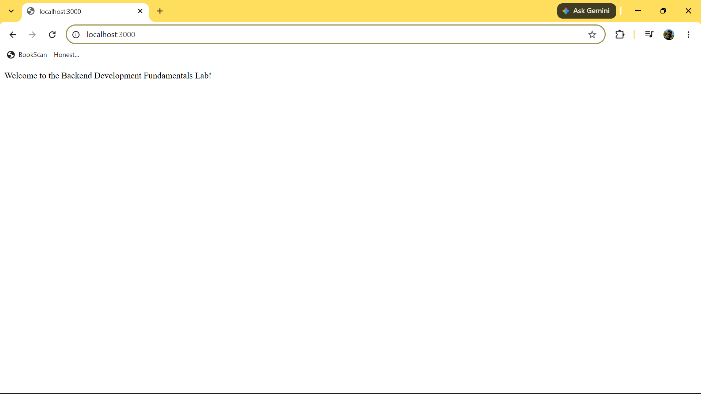
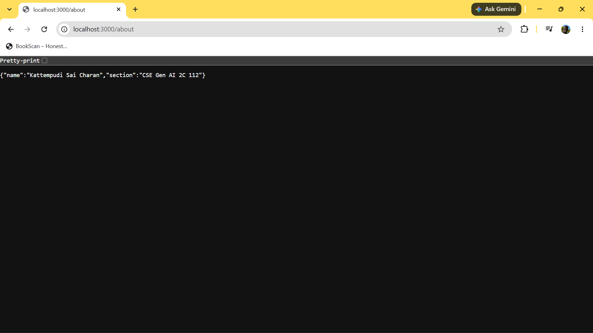
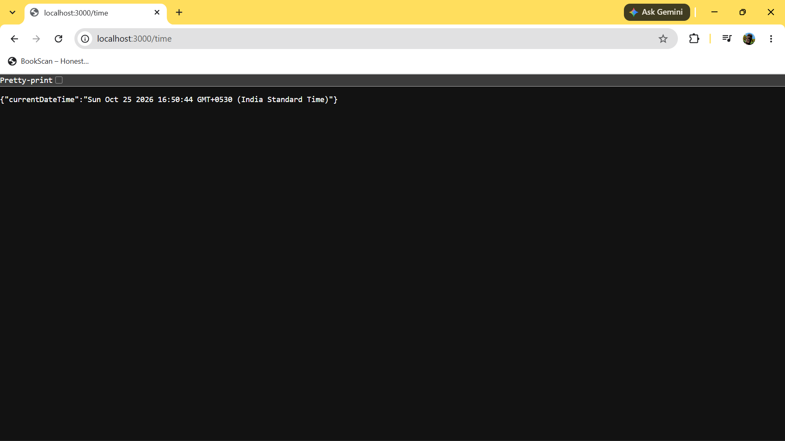
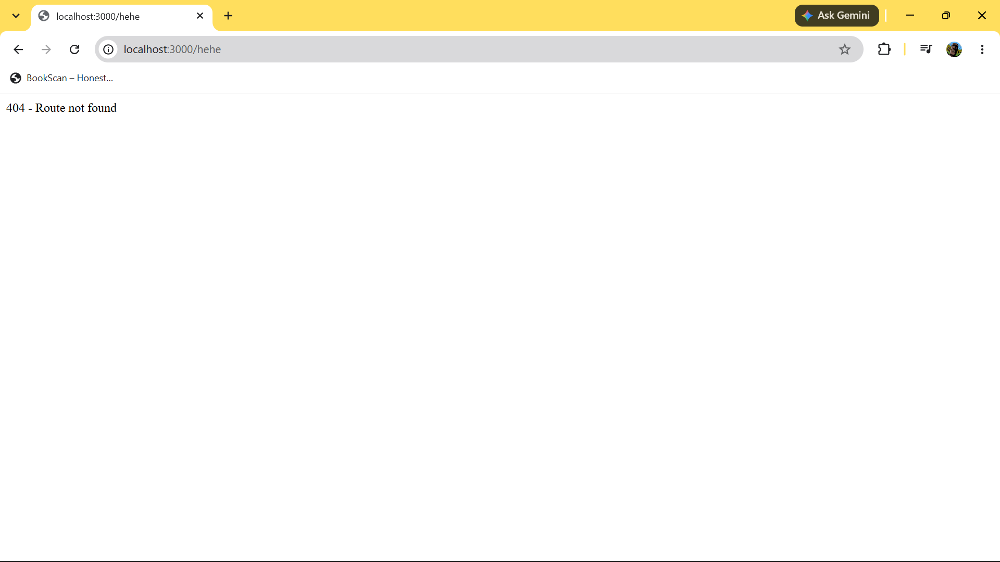

# Backend Development Fundamentals – Lab 1

## Student Details

- **Name:** Kattempudi Sai Charan
- **Registration Number:** 252U1R9151
- **Section:** CSE GEN AI 2C / 112

## Aim

To develop a basic HTTP server using Node.js and Express.js that handles different routes and returns appropriate responses.

## Technologies Used

- Node.js
- Express.js
- JavaScript
- Git and GitHub
- Render (deployment)

## Project Structure

```text
Module-1 Lab-1/
├── screenshots/
│   ├── home-route.png
│   ├── aboute-route.png
│   ├── time-route.png
│   └── not-found.png
├── .gitignore
├── package.json
├── package-lock.json
├── README.md
└── server.js
```

## Routes Implemented

| Method | Endpoint | Description | Response |
|---|---|---|---|
| GET | `/` | Home route | Welcome message |
| GET | `/about` | About route | Student details in JSON format |
| GET | `/time` | Time route | Current date and time in JSON format |
| GET | Any undefined route | Not-found handler | HTTP 404 response |

## Running the Project Locally

### Prerequisites

Install Node.js and npm on your system.

### Installation

Clone the repository:

```bash
git clone https://github.com/Saicharan-9151/Module-1-Lab-1.git
```

Move into the project directory:

```bash
cd Module-1-Lab-1
```

Install the dependencies:

```bash
npm install
```

Start the server:

```bash
npm start
```

The server will run at:

`http://localhost:3000`

## Testing the Routes

Open the following addresses in your browser after starting the server:

- Home: `http://localhost:3000/`
- About: `http://localhost:3000/about`
- Time: `http://localhost:3000/time`
- Not found: `http://localhost:3000/unknown`

## Screenshots

### Home Route



### About Route



### Time Route



### Not Found Route



## Deployment

The application will be deployed using Render.

**Live Application:** 
Link: [text](https://module-1-lab-1.onrender.com)

## GitHub Repository

[Module-1-Lab-1](https://github.com/Saicharan-9151/Module-1-Lab-1)

## Result

The Express server was implemented and tested successfully. The application handles the home, about, and time routes and returns an appropriate HTTP 404 response for undefined routes.